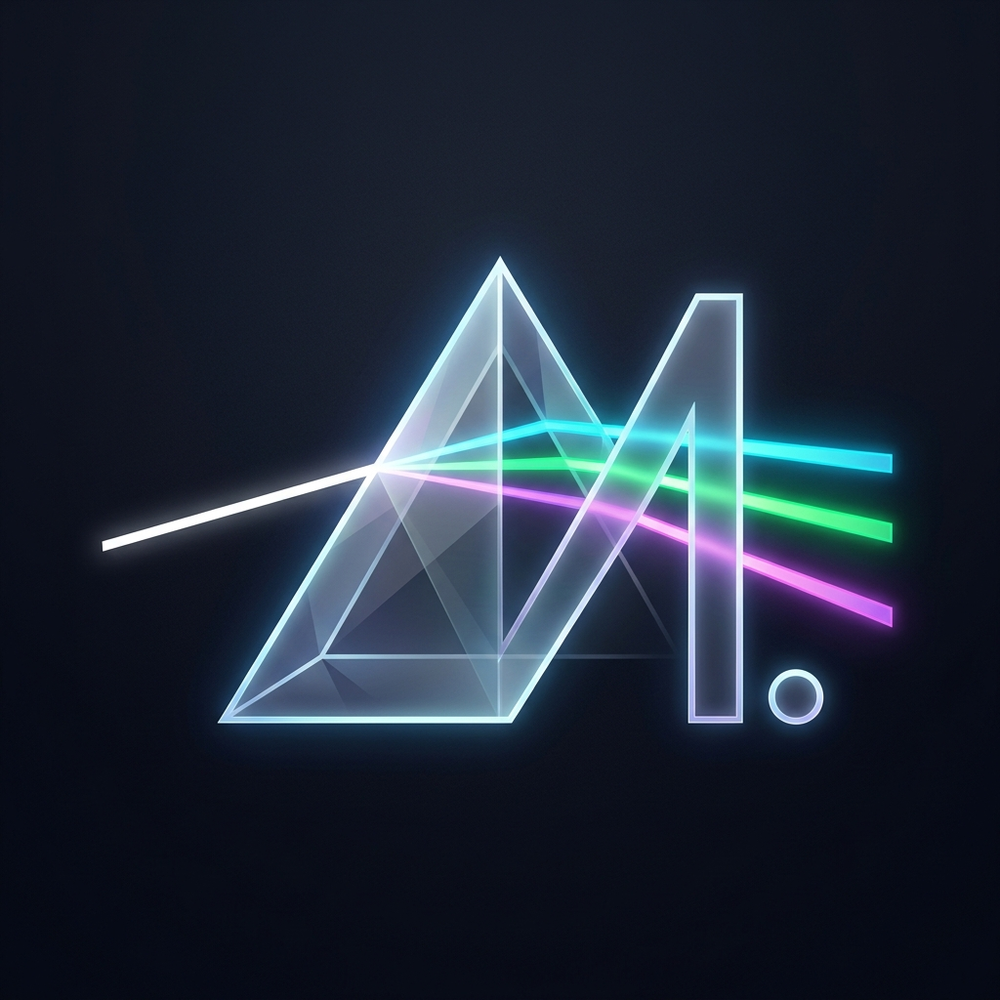

<p align="center">
  
</p>

# prisM. Suite

[](https://github.com/MOzcelik14/prism-suite/actions/workflows/ci.yml)
[](https://github.com/MOzcelik14/prism-suite/actions/workflows/release.yml)
[](https://www.gnu.org/licenses/gpl-3.0)
[](https://www.rust-lang.org)
[]()

**prisM. Suite** is a unified desktop launcher, installer, and auto-updater for a creative desktop software suite:
- **[triM.](https://github.com/MOzcelik14/triM)** — Precision non-linear video editing for desktop
- **[steM.](https://github.com/MOzcelik14/steM)** — Multitrack audio workstation & precision waveform editor
- **[beaM.](https://github.com/MOzcelik14/beaM)** — Creative photo editing & raster design studio

Target platforms: **Linux** (`x86_64`) and **Windows** (`x86_64`).

---

## 🎨 Branding & Identity

- **Suite Display Name**: `prisM. Suite` (used in window titles, installer, about dialog, documentation).
- **Launcher Compact Name**: `prisM.` (used in taskbars, system tray, desktop shortcuts).
- **Creative Apps**: `triM.`, `steM.`, `beaM.` (always resolved dynamically from the embedded catalog).
- **Visual Motif**: Deep obsidian (`#0e131f`) and slate dark theme with signature colored vector icons, bold capital "M", and trailing dot.

---

## 🏗️ Architecture & Member Crates

The project is structured as a modular Cargo workspace with zero circular dependencies:

```
prism-suite/
├── crates/
│   ├── prism-app/       # GUI front-end built on egui/eframe 0.29 (native look, dark theme, vector logos)
│   ├── prism-core/      # Domain models, embedded RON catalog, configuration, shared preferences, semver state
│   ├── prism-net/       # HTTP release discovery, chunked streaming, disk caching, Ed25519 & SHA-256 verifier
│   ├── prism-install/   # Atomic symlink management, archive extraction, desktop shortcuts, detached process runner
│   └── prism-i18n/      # Fluent localization (English & Turkish) with 100% key parity & Turkish character safety
├── docs/
│   ├── release-format.md    # Release contract specification, archive conventions & signatures
│   ├── shared-preferences.md# Specification for <config>/prism/shared.ron suite synchronization
│   └── signing.md           # Minisign / Ed25519 signing guide and GitHub Actions secret setup
├── scripts/
│   ├── package.sh       # Release packaging script for Linux and Windows archives
│   └── sign-release.sh  # Manifest generation and Minisign signature script
├── .github/workflows/
│   ├── ci.yml           # Automated testing, Clippy lints, and format checking on Linux & Windows
│   └── release.yml      # Automated matrix release build, checksumming, Minisign signing & GitHub Release
├── Cargo.toml
├── LICENSE
└── README.md
```

---

## 🛡️ Core Engineering Rules & Security

1. **Cryptographic Release Verification**:
   - Every downloaded archive is verified against `SHA256SUMS` and its detached Minisign signature (`SHA256SUMS.sig`) before unpacking.
   - Powered by `ed25519-dalek` and `sha2`.
   - Rejects corrupted downloads, hash mismatches, and tampered archives immediately.
2. **Path Traversal & Archive Hardening**:
   - Archive extraction explicitly sanitizes every entry path. Rejects relative directory traversal (`../`), absolute paths, and symlink escapes outside the target directory.
3. **Zero OpenSSL**:
   - Uses `reqwest` exclusively with `rustls-tls` to eliminate OpenSSL runtime linking and vulnerability issues.
4. **Atomic Installations & Instant Rollbacks**:
   - Uses atomic symlinks on Linux (`current.tmp` -> `rename`) and directory junction links on Windows.
   - Applications retain previous versions (`versions/<version>/`) allowing one-click rollback to the prior release with zero downtime.
   - Automatic version pruning keeps the last *N* versions configured by the user (default: 2, range: 1–5).
5. **Detached Process Management**:
   - Applications launch in their own detached process groups (`setsid` on Unix, creation flags on Windows) so they survive launcher shutdown.
   - Running state detection prevents updating, rolling back, or uninstalling active processes.
6. **Desktop Integration**:
   - Automatically installs and cleans up standard FreeDesktop `.desktop` entries in `~/.local/share/applications/` on Linux and shortcuts on Windows.
7. **Suite Preferences Synchronization**:
   - Maintains `<config>/prism/shared.ron` containing UI language and launcher version.
   - Child apps ([`triM.`](https://github.com/MOzcelik14/triM), [`steM.`](https://github.com/MOzcelik14/steM), [`beaM.`](https://github.com/MOzcelik14/beaM)) read this file on startup to synchronize their language automatically.
8. **Launcher Self-Update**:
   - Checks for updates to `prisM. Suite` itself against GitHub releases.
   - Linux: Atomic executable replacement (`current_exe -> current_exe.old -> new_exe -> current_exe`).
   - Windows: Detached helper script replaces the locked binary after process exit and relaunches.
9. **"What's New" Aggregated Release Feed**:
   - Dedicated feed rendering markdown release notes across all installed apps and the launcher in reverse chronological order.
10. **Localization & Full Turkish Character Safety**:
    - Fluent bundles for English (`en.ftl`) and Turkish (`tr.ftl`).
    - Automated tests enforce 100% key parity between locales.
    - Full support for Latin Extended-A characters (`ç, ğ, ı, İ, ö, ş, ü`) with zero naive uppercase/lowercase conversion bugs.

---

## 🚀 Building & Running

### Prerequisites
- **Rust**: Stable 1.80+ (recommended: `rustup default stable`).
- **Linux Build Dependencies**:
  ```bash
  sudo apt-get install -y libxcb-render0-dev libxcb-shape0-dev libxcb-xfixes0-dev libxkbcommon-dev libasound2-dev
  ```

### Build and Run Launcher
```bash
# Debug run
cargo run -p prism-app

# Optimized release run
cargo run --release -p prism-app
```

### Running Tests & Quality Checks
```bash
# Run all workspace unit and integration tests
cargo test --workspace

# Strict zero-warning linting
cargo clippy --workspace --all-targets -- -D warnings

# Formatting check
cargo fmt --check
```

---

## 📦 Packaging & Signing Releases

### Local Packaging
```bash
# Package archives for current platform into dist/
./scripts/package.sh
```

### Signing Release Assets
```bash
# Computes SHA256SUMS and signs with Minisign
./scripts/sign-release.sh dist/ path/to/prism.key
```

See [`docs/signing.md`](docs/signing.md) for detailed key generation and GitHub Actions setup instructions.

---

## 📄 License

This project is licensed under the **GNU General Public License v3.0 (GPL-3.0-only)**.
Copyright © 2026 Murat Özçelik. All rights reserved.
