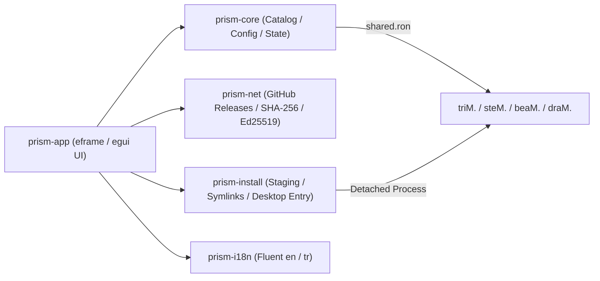

**English** | [Türkçe](README.tr.md)

<div align="center">


<h1>prisM. Suite</h1>

<p>An open-source creative desktop application suite and native management launcher built in Rust.</p>

<p>
  <a href="LICENSE"></a>
  <a href="https://github.com/MOzcelik14/prism-suite/releases"></a>
  <a href="https://www.rust-lang.org/"></a>
  <a href="#system-requirements"></a>
  <a href="https://github.com/MOzcelik14/prism-suite/commits/master"></a>
  <a href="#applications"></a>
</p>

<p>
  <a href="#overview">Overview</a> |
  <a href="#applications">Applications</a> |
  <a href="#suite-architecture">Suite Architecture</a> |
  <a href="#installation">Installation</a> |
  <a href="#system-requirements">System Requirements</a> |
  <a href="#roadmap">Roadmap</a> |
  <a href="#license">License</a>
</p>

<p>
  
</p>

</div>

---

## Overview

**prisM. Suite** is a coordinated ecosystem of independent, local-first creative desktop applications written in Rust, paired with a native desktop launcher and package supervisor. The suite covers video editing (**triM.**), multi-track audio production (**steM.**), non-destructive RAW photo development (**beaM.**), and screenwriting (**draM.**).

Every application in the suite operates as a standalone native binary with direct filesystem storage, zero telemetry, and no user account or cloud subscription requirements. The **prisM. Suite** launcher provides a single interface to discover releases, verify downloads, manage versioned installations, and launch or roll back applications on Linux and Windows.

## Highlights

- **Unified Desktop Hub**: Install, update, launch, roll back, and uninstall **triM.**, **steM.**, **beaM.**, and **draM.** from a single native interface.
- **Verified Package Delivery**: Downloads from GitHub Releases are checked against `SHA256SUMS` manifests and optional Ed25519 / Minisign signatures before extraction, with path-traversal sanitization in the archive extractor.
- **Atomic Version Switching and Rollback**: Each application version is extracted into an isolated version directory and activated via a `current` symlink (or directory junction on Windows), keeping the `previous` release available for one-click rollback.
- **Detached Process Execution**: Applications run in independent OS process trees so closing or updating the launcher does not interrupt active editing sessions.
- **Shared Bilingual Experience**: Both the launcher and every suite application ship with built-in English and Turkish localization, with shared language preferences coordinated via `shared.ron`.

## Applications

| Application | Purpose | Status | Latest Release | Platform | Repository |
| :--- | :--- | :--- | :--- | :--- | :--- |
| **triM.** | Non-linear video editor | Stable | [](https://github.com/MOzcelik14/triM/releases) | Linux, Windows | [MOzcelik14/triM](https://github.com/MOzcelik14/triM) |
| **steM.** | Multi-track audio workstation and waveform editor | Active development | [](https://github.com/MOzcelik14/steM/releases) | Linux, Windows | [MOzcelik14/steM](https://github.com/MOzcelik14/steM) |
| **beaM.** | Non-destructive RAW photo developer and catalog | Stable | [](https://github.com/MOzcelik14/beaM/releases) | Linux, Windows | [MOzcelik14/beaM](https://github.com/MOzcelik14/beaM) |
| **draM.** | Screenplay editor and PDF pagination tool | Stable | [](https://github.com/MOzcelik14/draM/releases) | Linux, macOS, Windows | [MOzcelik14/draM](https://github.com/MOzcelik14/draM) |

### triM.

**triM.** is a local-first non-linear video editor combining an `egui` interface, an OpenGL 3.3 / GLES 3.0 framebuffer preview compositor with CPU fallback, and an FFmpeg-based decoding and export pipeline. It supports unlimited video and audio tracks, Lift/Gamma/Gain color wheels, `.cube` 3D LUTs, video scopes, multi-track 48 kHz audio mixing, subtitles, and EDL/FCPXML interchange. Project state is stored in atomic `.trim` JSON files. See the [triM. README](https://github.com/MOzcelik14/triM/blob/master/README.md) for full details.

### steM.

**steM.** is a non-destructive multi-track digital audio workstation and sample-level waveform editor built in Rust with a lock-free `cpal` / `rtrb` audio engine. It provides up to 64 tracks, submix busses, auxiliary sends, real-time DSP chains, spectral repair and noise reduction, EBU R128 loudness metering, and multi-channel recording. Projects are stored in human-readable `.stem` RON files without modifying source audio on disk. See the [steM. README](https://github.com/MOzcelik14/steM/blob/master/README.md) for full details.

### beaM.

**beaM.** is a non-destructive RAW photo developer and SQLite-backed local library manager built with `rawler`, `wgpu`, and `moxcms`. Image processing runs in 32-bit floating-point Linear Rec.2020 space across modular WGSL shaders, supporting tone curves, 8-band HSL, 3-way color grading, local gradient and brush masks, soft proofing, and tiled high-resolution export. Original camera files remain untouched while edits live in `.beam` sidecar files. See the [beaM. README](https://github.com/MOzcelik14/beaM/blob/master/README.md) for full details.

### draM.

**draM.** is a safe-Rust (`#![forbid(unsafe_code)]`) screenplay writing application designed around both Turkish and English screenplay formatting rules, decoupled from the active UI language. It features live page-break pagination, dual dialogue columns, an index card beat board, revision marks, character and location breakdown reports, Fountain/FDX/Fade In interchange, and embedded Courier Prime PDF export. Projects are saved in versioned `.dram` ZIP archives. See the [draM. README](https://github.com/MOzcelik14/draM/blob/main/README.md) for full details.

## Design Principles

- **Local-first and offline-capable**: All creative applications store projects, sidecars, and catalogs locally on disk without cloud dependencies, telemetry, or user accounts.
- **Non-destructive workflows**: Media editors (`triM.`, `steM.`, `beaM.`) preserve original video, audio, and camera RAW files untouched, recording edits in structured project or sidecar files until explicit export.
- **Native Rust execution**: Every tool compiles to a native executable using `eframe` and `egui` for immediate-mode UI rendering without browser runtimes.
- **Bilingual parity from the core**: English and Turkish translations are embedded directly in each application using Fluent (`en.ftl` and `tr.ftl`), with runtime switching.
- **Atomic persistence**: Project saves, sidecar writes, and launcher package deployments use staging and atomic rename patterns to prevent corruption during interruptions.

## Suite Architecture

The **prisM. Suite** launcher (`crates/prism-app`) coordinates `prism-core`, `prism-net`, `prism-install`, and `prism-i18n` to manage the lifecycle of suite applications independently of the applications themselves.



1. **Release discovery**: `prism-net` queries the GitHub Releases API for each entry in the embedded catalog (`catalog.ron`), filters platform-matching archives, and surfaces available updates and release notes in the UI.
2. **Integrity verification**: Before installation, downloaded archives are validated against `SHA256SUMS` checksum manifests and, when a `.minisig` or `.sig` signature file is present, verified using Ed25519 public-key cryptography.
3. **Staged installation and rollback**: `prism-install` extracts archives with path-traversal protection into `apps/<id>/staging/<version>`, moves the validated tree into `apps/<id>/versions/<version>`, updates `previous` and `current` symlinks (or directory junctions on Windows), and registers `.desktop` entries with application icons on Linux. Rolling back swaps `current` back to `previous` without re-downloading.
4. **Launcher self-update**: The launcher checks `MOzcelik14/prism-suite` releases and stages binary self-updates via `prism-install::self_update`, falling back to user-local installation paths if a system binary location is read-only.
5. **Shared preferences**: Language selection and launcher version metadata are written to `shared.ron` in the user config directory so suite applications can read the preferred suite language.

## Installation

### Via prisM. Suite Launcher (Recommended)

Download the launcher package for your operating system from the [prisM. Suite Releases](https://github.com/MOzcelik14/prism-suite/releases) page:

- **Debian / Ubuntu (`.deb`)**:
  ```bash
  sudo dpkg -i prism_1.2.0_amd64.deb
  sudo apt-get install -f
  ```
- **Fedora / RHEL (`.rpm`)**:
  ```bash
  sudo dnf install ./prism-1.2.0-1.x86_64.rpm
  ```
- **Universal Linux (`.AppImage`)**:
  ```bash
  chmod +x prism-1.2.0-x86_64.AppImage
  ./prism-1.2.0-x86_64.AppImage
  ```
- **Portable Linux (`.tar.gz`)**:
  ```bash
  tar -xzf prism-1.2.0-linux-x86_64.tar.gz
  ./prism
  ```
- **Windows (`x86_64`)**: Extract `prism-1.2.0-windows-x86_64.zip` and run `prism.exe`.

### Installing Applications Individually

Each application publishes standalone builds on its own GitHub Releases page for users who prefer direct installation without the launcher:

- **triM.**: [MOzcelik14/triM Releases](https://github.com/MOzcelik14/triM/releases) (`.deb`, `.rpm`, `.AppImage`, `.tar.gz`, Windows `.zip`, plus `install.sh` / `install.ps1`)
- **steM.**: [MOzcelik14/steM Releases](https://github.com/MOzcelik14/steM/releases) (Linux `.tar.gz`, Windows `.zip`)
- **beaM.**: [MOzcelik14/beaM Releases](https://github.com/MOzcelik14/beaM/releases) (`.deb`, `.rpm`, `.AppImage`, `.tar.gz`, Windows `.exe` installer and `.zip`)
- **draM.**: [MOzcelik14/draM Releases](https://github.com/MOzcelik14/draM/releases) (`.deb`, Linux `.tar.gz`, macOS arm64 `.tar.gz`, Windows `.zip`)

### Building the Launcher from Source

Requires Rust 1.80+ (2021 edition) and standard X11/Wayland/ALSA development headers on Debian/Ubuntu:

```bash
sudo apt-get install -y build-essential libxcb-render0-dev libxcb-shape0-dev \
  libxcb-xfixes0-dev libxkbcommon-dev libasound2-dev
git clone https://github.com/MOzcelik14/prism-suite.git
cd prism-suite
cargo build --release -p prism-app
```

## Getting Started

1. Launch **prisM. Suite** (`prism` on Linux or `prism.exe` on Windows).
2. Open the **Applications** view to see installation status and the latest available releases for **triM.**, **steM.**, **beaM.**, and **draM.**.
3. Click **Install** on any application card to download, verify, and stage the latest release. Once installed, **Launch** opens the application in an independent process and registers desktop menu shortcuts on Linux.
4. Use **Settings** in the left rail to switch between English and Turkish, configure release check frequency, select stable or beta channels, or set a custom installation directory.
5. Check **What's New** to review recent release notes across the ecosystem.

## System Requirements

| Component | Common Baseline | Application-Specific Notes |
| :--- | :--- | :--- |
| Operating System | 64-bit Linux (glibc 2.31+ / Ubuntu 22.04+ recommended) or Windows 10/11 (64-bit) | **draM.** also provides macOS (`arm64`) release builds. |
| Processor | 64-bit multi-core CPU | **triM.** recommends 6+ cores for multi-track video decoding and software encoding. |
| Memory | 4 GB RAM minimum (8 GB recommended) | **triM.** and **beaM.** benefit from 8 GB+ for 4K timelines and batch RAW exports. |
| Graphics | Hardware-accelerated GPU | **triM.** uses OpenGL 3.3 / GLES 3.0 (with CPU fallback); **beaM.** requires Vulkan 1.2+ (Linux/Windows) or DirectX 12 (Windows); **steM.** and **draM.** run on standard desktop graphics. |
| Runtime Dependencies | None for the launcher | **triM.** requires `ffmpeg` and `ffprobe` in `PATH` on Linux (bundled on Windows); **steM.** uses ALSA/PulseAudio/PipeWire on Linux or WASAPI on Windows; **draM.** uses CUPS (`lp`/`lpr`) on Unix for direct printing. |

## Shared Conventions

- **Cargo workspace layout**: All five repositories use Rust 2021 workspaces organized into focused domain, engine/format, localization, and `eframe`/`egui` application crates under `crates/`.
- **Localization architecture**: User-facing strings are stored in Fluent `.ftl` bundles (`en.ftl` and `tr.ftl`) and verified for key parity in automated tests.
- **Keyboard shortcut conventions**: Desktop applications follow standard modifier bindings (`Ctrl+S` save, `Ctrl+Z` / `Ctrl+Y` undo/redo, `Ctrl+F` find, `Ctrl+,` preferences where applicable).
- **Semantic versioning**: All suite repositories follow Semantic Versioning (`MAJOR.MINOR.PATCH`) with annotated `v*` Git tags triggering multi-platform GitHub Actions release workflows.
- **Commit convention**: Repositories use Conventional Commits prefixes (`feat:`, `fix:`, `docs:`, `chore:`, `style:`) across release and maintenance history.

## Roadmap

Each component maintains its own roadmap tracked in its repository:

- **prisM. Suite (Launcher)**: Core catalog management, SHA-256 and Ed25519 verification, atomic symlinks/junctions, rollback, Linux `.desktop` integration, self-update, and reactive UI updates are implemented in `v1.2.0`. Ongoing maintenance tracks packaging and release sync automation.
- **triM.**: Active work tracked in `ROADMAP.md` includes customizable keybindings with conflict detection, Wayland fractional scaling alignment, content-addressed disk cache eviction, and GLSL shader migration for curves and HSL qualifiers.
- **steM.**: Core multi-track editing, DSP chains, spectral restoration, and mastering analysis are implemented in `v0.6.1`; remaining verification focuses on physical hardware testing across PipeWire, JACK, and ALSA setups.
- **beaM.**: Feature milestones through `v1.2.6` are released; ongoing direction covers broader camera RAW format support via upstream `rawler`, additional localizations, and performance refinements.
- **draM.**: All 12 planned `ROADMAP.md` milestones shipped in `v1.0.0`; future enhancements are scoped via GitHub Issues.

## FAQ

**Does prisM. Suite require an account or internet connection to use installed apps?**
No. An internet connection is only used when checking for or downloading updates from GitHub Releases. Installed applications run completely offline.

**Where are applications installed by default?**
On Linux, applications are staged under `~/.local/share/prism-suite/apps/<app_id>/` (with `.desktop` entries in `~/.local/share/applications/`). On Windows, they are placed under `%LOCALAPPDATA%\prism-suite\apps\<app_id>\`. You can change the install root in Settings.

**Does closing or updating the launcher close running applications?**
No. Applications are launched as detached OS processes and continue running independently.

**How do I revert an application update if something breaks?**
Open **Details** on the application card and click **Roll Back** to switch `current` back to the `previous` installed version immediately.

**Can I use the applications without installing the launcher?**
Yes. Every application is distributed as a standalone package on its own GitHub Releases page.

## Contributing

Issues, bug reports, and pull requests should be filed directly in the repository corresponding to the component:

- Launcher UI, installation, verification, or catalog issues: [MOzcelik14/prism-suite](https://github.com/MOzcelik14/prism-suite/issues)
- Video timeline, color grading, or FFmpeg export issues: [MOzcelik14/triM](https://github.com/MOzcelik14/triM/issues)
- Audio engine, DSP, or multi-track mixing issues: [MOzcelik14/steM](https://github.com/MOzcelik14/steM/issues)
- RAW decoding, GPU shaders, or photo library issues: [MOzcelik14/beaM](https://github.com/MOzcelik14/beaM/issues)
- Screenplay formatting, pagination, or PDF export issues: [MOzcelik14/draM](https://github.com/MOzcelik14/draM/issues)

Before opening a pull request in any workspace, run `cargo fmt --check`, `cargo clippy --workspace --all-targets -- -D warnings`, and `cargo test --workspace`.

## Localization

**prisM. Suite** and its applications natively support **English** (`en`) and **Turkish** (`tr`) using [Project Fluent](https://projectfluent.org/) bundles. Launcher translations live in `crates/prism-i18n/locales/en.ftl` and `crates/prism-i18n/locales/tr.ftl`, enforced by strict key-parity tests in `crates/prism-i18n/tests/parity.rs`. Setting the language in the launcher updates `shared.ron` for suite integration.

## License

| Repository | License | License File |
| :--- | :--- | :--- |
| **prisM. Suite** (`prism-suite`) | GNU General Public License v3.0 only (`GPL-3.0-only`) | [LICENSE](LICENSE) |
| **triM.** (`triM`) | GNU General Public License v3.0 or later (`GPL-3.0-or-later`) | [triM LICENSE](https://github.com/MOzcelik14/triM/blob/master/LICENSE) |
| **steM.** (`steM`) | GNU General Public License v3.0 or later (`GPL-3.0-or-later`) | [steM LICENSE](https://github.com/MOzcelik14/steM/blob/master/LICENSE) |
| **beaM.** (`beaM`) | GNU General Public License v3.0 only (`GPL-3.0-only`) | [beaM LICENSE](https://github.com/MOzcelik14/beaM/blob/master/LICENSE) |
| **draM.** (`draM`) | Dual-licensed under MIT or Apache-2.0 (`MIT OR Apache-2.0`) | [draM LICENSE-MIT](https://github.com/MOzcelik14/draM/blob/main/LICENSE-MIT) / [LICENSE-APACHE](https://github.com/MOzcelik14/draM/blob/main/LICENSE-APACHE) |

## Acknowledgements

The **prisM. Suite** launcher builds on the following open-source crates and specifications:

| Dependency | Role | License |
| :--- | :--- | :--- |
| [egui](https://github.com/emilk/egui) / [eframe](https://github.com/emilk/egui) | Immediate-mode GUI framework and native windowing | MIT / Apache-2.0 |
| [egui_commonmark](https://github.com/lampsitter/egui_commonmark) | Release notes Markdown rendering | MIT / Apache-2.0 |
| [tokio](https://tokio.rs/) / [reqwest](https://github.com/seanmonstar/reqwest) | Asynchronous runtime and GitHub Releases HTTP client | MIT / Apache-2.0 |
| [ed25519-dalek](https://github.com/dalek-cryptography/ed25519-dalek) / `sha2` | Cryptographic signature and SHA-256 integrity verification | BSD-3-Clause / MIT / Apache-2.0 |
| [resvg](https://github.com/RazrFalcon/resvg) | Vector logo rasterization | MPL-2.0 |
| [fluent-bundle](https://github.com/projectfluent/fluent-rs) | English and Turkish localization engine | MIT / Apache-2.0 |
| [tar](https://github.com/alexcrichton/tar-rs) / `flate2` / `zip` | Safe archive extraction | MIT / Apache-2.0 |

## Contact

- **Suite Portal**: [mozcelik14.github.io/prism-suite](https://mozcelik14.github.io/prism-suite/)
- **Repository**: [github.com/MOzcelik14/prism-suite](https://github.com/MOzcelik14/prism-suite)
- **Issues and Bug Reports**: [github.com/MOzcelik14/prism-suite/issues](https://github.com/MOzcelik14/prism-suite/issues)
- **Maintainer**: Murat Özçelik ([github.com/MOzcelik14](https://github.com/MOzcelik14))

---

<div align="center">
  <p><a href="https://mozcelik14.github.io/prism-suite/">prisM. Suite</a> · <a href="https://github.com/MOzcelik14/triM">triM.</a> · <a href="https://github.com/MOzcelik14/steM">steM.</a> · <a href="https://github.com/MOzcelik14/beaM">beaM.</a> · <a href="https://github.com/MOzcelik14/draM">draM.</a></p>
</div>
