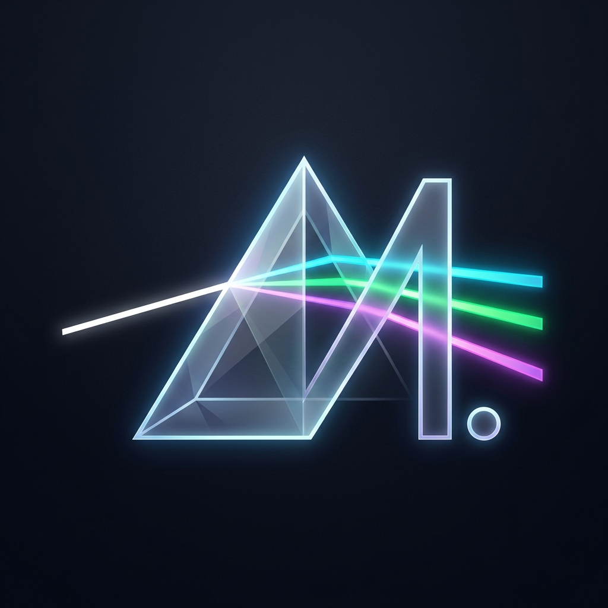
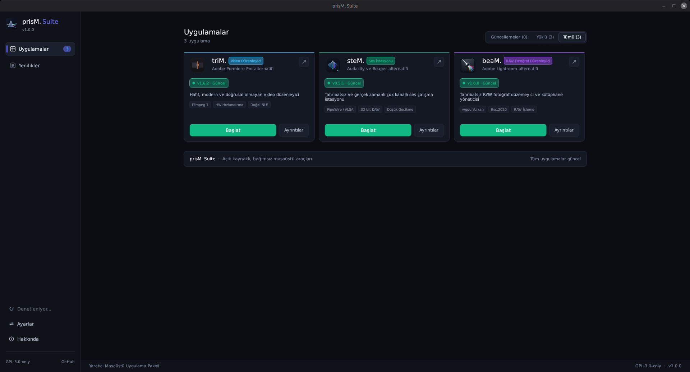
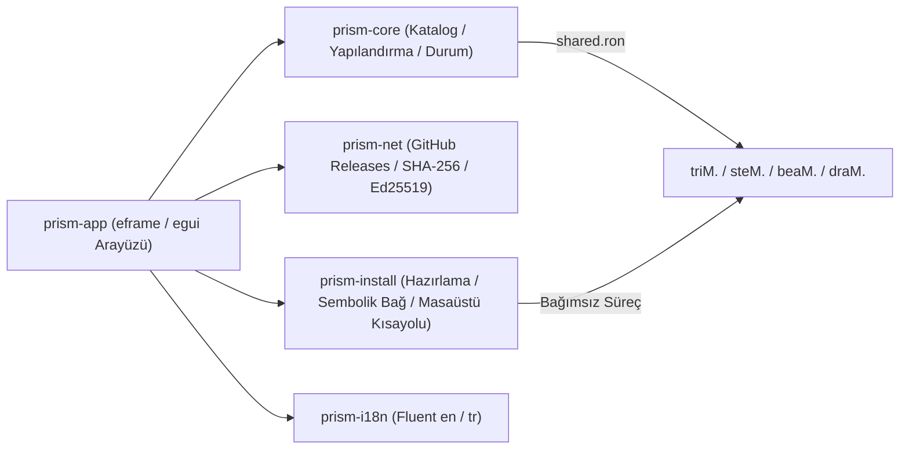

[English](README.md) | **Türkçe**

<div align="center">



<h1>prisM. Suite</h1>

<p>Rust ile geliştirilmiş açık kaynaklı yaratıcı masaüstü uygulama paketi ve yerel yönetim başlatıcısı.</p>

<p>
  <a href="LICENSE"></a>
  <a href="https://github.com/MOzcelik14/prism-suite/releases"></a>
  <a href="https://www.rust-lang.org/"></a>
  <a href="#system-requirements"></a>
  <a href="https://github.com/MOzcelik14/prism-suite/commits/master"></a>
  <a href="#applications"></a>
</p>

<p>
  <a href="#genel-bakış">Genel Bakış</a> |
  <a href="#uygulamalar">Uygulamalar</a> |
  <a href="#paket-mimarisi">Paket Mimarisi</a> |
  <a href="#kurulum">Kurulum</a> |
  <a href="#sistem-gereksinimleri">Sistem Gereksinimleri</a> |
  <a href="#yol-haritası">Yol Haritası</a> |
  <a href="#lisans">Lisans</a>
</p>

<p>
  
</p>

</div>

---

## Genel Bakış

**prisM. Suite**, Rust ile geliştirilmiş bağımsız, yerel öncelikli yaratıcı masaüstü uygulamalarını ve bu uygulamaları tek merkezden yöneten yerel masaüstü başlatıcısını bir araya getiren açık kaynaklı bir ekosistemdir. Paket; video kurgu (**triM.**), çok kanallı ses üretimi (**steM.**), tahribatsız RAW fotoğraf geliştirme (**beaM.**) ve senaryo yazımı (**draM.**) araçlarını kapsar.

Ekosistemdeki her uygulama doğrudan dosya sistemi üzerinde çalışan bağımsız bir yerel ikili dosya olarak çalışır; telemetri toplamaz, kullanıcı hesabı veya bulut aboneliği gerektirmez. **prisM. Suite** başlatıcısı ise Linux ve Windows sistemlerde sürümleri keşfetmek, indirmeleri doğrulamak, sürümlenmiş kurulumları yönetmek ve uygulamaları başlatmak ya da eski sürüme geri almak için tek bir arayüz sunar.

## Öne Çıkan Özellikler

- **Tek Merkezden Yönetim**: **triM.**, **steM.**, **beaM.** ve **draM.** uygulamalarını tek bir yerel arayüz üzerinden kurun, güncelleyin, başlatın, geri alın veya kaldırın.
- **Doğrulanmış Paket Dağıtımı**: GitHub Releases üzerinden indirilen arşivler ayıklanmadan önce `SHA256SUMS` sağlama toplamları ve mevcut olduğunda Ed25519 / Minisign imzalarıyla doğrulanır; arşiv ayıklayıcı dizin atlama saldırılarına karşı korumalıdır.
- **Atomik Sürüm Geçişi ve Geri Alma**: Her sürüm ayrı bir sürüm dizinine kurulur ve `current` sembolik bağı (Windows üzerinde dizin bağlantısı) ile etkinleştirilir; önceki sürüm `previous` bağlantısıyla tek tıkla geri dönüş için saklanır.
- **Bağımsız Süreç Çalıştırma**: Uygulamalar kendi işletim sistemi süreç ağaçlarında çalışır; başlatıcıyı kapatmak veya güncellemek açık olan düzenleme oturumlarını kesintiye uğratmaz.
- **Ortak İki Dilli Deneyim**: Hem başlatıcı hem de paketteki tüm uygulamalar yerleşik İngilizce ve Türkçe dil desteğiyle gelir; ortak dil tercihi `shared.ron` üzerinden koordine edilir.

## Uygulamalar

| Uygulama | Amaç | Durum | Son Sürüm | Platform | Depo |
| :--- | :--- | :--- | :--- | :--- | :--- |
| **triM.** | Doğrusal olmayan video düzenleyici | Kararlı | [](https://github.com/MOzcelik14/triM/releases) | Linux, Windows | [MOzcelik14/triM](https://github.com/MOzcelik14/triM) |
| **steM.** | Çok kanallı ses istasyonu ve dalga formu düzenleyici | Aktif geliştirme | [](https://github.com/MOzcelik14/steM/releases) | Linux, Windows | [MOzcelik14/steM](https://github.com/MOzcelik14/steM) |
| **beaM.** | Tahribatsız RAW fotoğraf geliştirici ve katalog yöneticisi | Kararlı | [](https://github.com/MOzcelik14/beaM/releases) | Linux, Windows | [MOzcelik14/beaM](https://github.com/MOzcelik14/beaM) |
| **draM.** | Senaryo editörü ve PDF sayfalama aracı | Kararlı | [](https://github.com/MOzcelik14/draM/releases) | Linux, macOS, Windows | [MOzcelik14/draM](https://github.com/MOzcelik14/draM) |

### triM.

**triM.**, `egui` arayüzünü, CPU yedekli OpenGL 3.3 / GLES 3.0 önizleme birleştiricisini ve FFmpeg tabanlı çözme/dışa aktarma hattını birleştiren yerel öncelikli doğrusal olmayan bir video düzenleyicidir. Sınırsız video ve ses kanalı, Lift/Gamma/Gain renk tekerlekleri, `.cube` 3D LUT desteği, video kapsamları, 48 kHz çok kanallı ses mikseri, alt yazı ve EDL/FCPXML aktarımı sunar. Proje durumu atomik `.trim` JSON dosyalarında saklanır. Ayrıntılar için [triM. README](https://github.com/MOzcelik14/triM/blob/master/README.tr.md) dosyasına bakın.

### steM.

**steM.**, kilitlenmeyen `cpal` / `rtrb` ses motoruyla Rust dilinde geliştirilmiş tahribatsız çok kanallı bir ses çalışma istasyonu ve örnek düzeyinde dalga formu düzenleyicisidir. 64 kanala kadar düzenleme, alt miks veriyolları, yardımcı gönderimler, gerçek zamanlı DSP zincirleri, spektral onarım ve gürültü azaltma, EBU R128 ses yüksekliği ölçümü ve çok kanallı kayıt sunar. Projeler diskteki kaynak ses dosyalarına dokunmadan okunabilir `.stem` RON dosyalarında saklanır. Ayrıntılar için [steM. README](https://github.com/MOzcelik14/steM/blob/master/README.tr.md) dosyasına bakın.

### beaM.

**beaM.**, `rawler`, `wgpu` ve `moxcms` üzerine kurulu tahribatsız bir RAW fotoğraf geliştirici ve SQLite tabanlı yerel kütüphane yöneticisidir. Görüntü işleme, modüler WGSL gölgelendiricileri üzerinden 32-bit kayan noktalı Lineer Rec.2020 uzayında çalışır; ton eğrileri, 8 bant HSL, 3 yollu renk düzenleme, yerel gradyan ve fırça maskeleri, yumuşak prova ve yüksek çözünürlüklü parçalı dışa aktarma desteği sunar. Orijinal kamera dosyaları korunurken düzenlemeler `.beam` yan dosyalarında tutulur. Ayrıntılar için [beaM. README](https://github.com/MOzcelik14/beaM/blob/master/README.tr.md) dosyasına bakın.

### draM.

**draM.**, aktif arayüz dilinden bağımsız olarak hem Türkçe hem İngilizce senaryo biçimlendirme kurallarına göre tasarlanmış, tamamen güvenli Rust (`#![forbid(unsafe_code)]`) ile yazılmış bir senaryo editörüdür. Canlı sayfa sonu hesaplama, ikili diyalog sütunları, indeks kartları (Beat Board), revizyon işaretleri, karakter ve mekân döküm raporları, Fountain/FDX/Fade In uyumu ve gömülü Courier Prime PDF çıktısı sunar. Projeler sürümlenmiş `.dram` ZIP arşivlerinde saklanır. Ayrıntılar için [draM. README](https://github.com/MOzcelik14/draM/blob/main/README.tr.md) dosyasına bakın.

## Tasarım İlkeleri

- **Yerel öncelikli ve çevrimdışı**: Tüm yaratıcı uygulamalar projeleri, yan dosyaları ve katalogları bulut bağımlılığı, telemetri veya kullanıcı hesabı olmadan doğrudan yerel diskte saklar.
- **Tahribatsız iş akışı**: Medya düzenleyiciler (`triM.`, `steM.`, `beaM.`) orijinal video, ses ve kamera RAW dosyalarını değiştirmeden korur; düzenlemeleri dışa aktarıma kadar yapılandırılmış proje veya yan dosyalarda tutar.
- **Doğal Rust yürütmesi**: Her araç tarayıcı çalışma zamanı kullanmadan doğrudan `eframe` ve `egui` ile yerel ikili dosya olarak derlenir.
- **Çekirdekten iki dillilik**: İngilizce ve Türkçe çeviriler Fluent (`en.ftl` ve `tr.ftl`) ile doğrudan her uygulamanın içine gömülüdür ve çalışma zamanında değiştirilebilir.
- **Atomik veri kaydı**: Proje kayıtları, yan dosya yazımları ve başlatıcı paket kurulumları kesintilerde bozulmayı önlemek için hazırlama ve atomik yeniden adlandırma yöntemini kullanır.

## Paket Mimarisi

**prisM. Suite** başlatıcısı (`crates/prism-app`), uygulamaların yaşam döngüsünü uygulamalardan bağımsız biçimde yönetmek için `prism-core`, `prism-net`, `prism-install` ve `prism-i18n` paketlerini koordine eder.



1. **Sürüm keşfi**: `prism-net`, gömülü katalogdaki (`catalog.ron`) her uygulama için GitHub Releases API üzerinden son sürümleri sorgular, platforma uygun arşivleri filtreler ve sürüm notlarını arayüzde gösterir.
2. **Bütünlük doğrulaması**: Kurulum öncesinde indirilen arşivler `SHA256SUMS` özet listelerine karşı kontrol edilir ve `.minisig` veya `.sig` dosyası mevcutsa Ed25519 açık anahtar kriptografisiyle doğrulanır.
3. **Aşamalı kurulum ve geri alma**: `prism-install`, arşivleri dizin atlama korumasıyla `apps/<id>/staging/<version>` içine ayıklar, doğrulanmış dizini `apps/<id>/versions/<version>` konumuna taşır, `previous` ve `current` sembolik bağlarını (Windows'ta dizin bağlantısını) günceller ve Linux üzerinde uygulama simgeleriyle `.desktop` kısayolları oluşturur. Geri alma işlemi yeniden indirme yapmadan `current` bağını `previous` sürümüne çevirir.
4. **Başlatıcı öz güncellemesi**: Başlatıcı `MOzcelik14/prism-suite` sürümlerini denetler ve `prism-install::self_update` üzerinden kendi ikili dosyasını günceller; sistem ikili dizini salt okunursa kullanıcı alanındaki dizine kurulum yapar.
5. **Ortak tercihler**: Dil seçimi ve başlatıcı sürüm bilgisi kullanıcı yapılandırma dizinindeki `shared.ron` dosyasına yazılır; böylece paket uygulamaları ortak dil tercihini okuyabilir.

## Kurulum

### prisM. Suite Başlatıcısı ile (Önerilen)

İşletim sisteminize uygun başlatıcı paketini [prisM. Suite Releases](https://github.com/MOzcelik14/prism-suite/releases) sayfasından indirin:

- **Debian / Ubuntu (`.deb`)**:
  ```bash
  sudo dpkg -i prism_1.2.0_amd64.deb
  sudo apt-get install -f
  ```
- **Fedora / RHEL (`.rpm`)**:
  ```bash
  sudo dnf install ./prism-1.2.0-1.x86_64.rpm
  ```
- **Evrensel Linux (`.AppImage`)**:
  ```bash
  chmod +x prism-1.2.0-x86_64.AppImage
  ./prism-1.2.0-x86_64.AppImage
  ```
- **Taşınabilir Linux (`.tar.gz`)**:
  ```bash
  tar -xzf prism-1.2.0-linux-x86_64.tar.gz
  ./prism
  ```
- **Windows (`x86_64`)**: `prism-1.2.0-windows-x86_64.zip` arşivini açın ve `prism.exe` dosyasını çalıştırın.

### Uygulamaları Tek Tek Kurma

Başlatıcıyı kullanmadan doğrudan kurulum yapmak isteyen kullanıcılar için her uygulama kendi GitHub Releases sayfasında bağımsız paketler yayınlar:

- **triM.**: [MOzcelik14/triM Releases](https://github.com/MOzcelik14/triM/releases) (`.deb`, `.rpm`, `.AppImage`, `.tar.gz`, Windows `.zip`, ayrıca `install.sh` / `install.ps1`)
- **steM.**: [MOzcelik14/steM Releases](https://github.com/MOzcelik14/steM/releases) (Linux `.tar.gz`, Windows `.zip`)
- **beaM.**: [MOzcelik14/beaM Releases](https://github.com/MOzcelik14/beaM/releases) (`.deb`, `.rpm`, `.AppImage`, `.tar.gz`, Windows `.exe` kurulum ve `.zip`)
- **draM.**: [MOzcelik14/draM Releases](https://github.com/MOzcelik14/draM/releases) (`.deb`, Linux `.tar.gz`, macOS arm64 `.tar.gz`, Windows `.zip`)

### Kaynaktan Derleme

Rust 1.80+ (2021 edition) ve Debian/Ubuntu üzerinde standart X11/Wayland/ALSA geliştirme kütüphaneleri gerekir:

```bash
sudo apt-get install -y build-essential libxcb-render0-dev libxcb-shape0-dev \
  libxcb-xfixes0-dev libxkbcommon-dev libasound2-dev
git clone https://github.com/MOzcelik14/prism-suite.git
cd prism-suite
cargo build --release -p prism-app
```

## Başlarken

1. **prisM. Suite** uygulamasını başlatın (Linux'ta `prism`, Windows'ta `prism.exe`).
2. **Uygulamalar** görünümünde **triM.**, **steM.**, **beaM.** ve **draM.** için kurulum durumunu ve güncel sürümleri inceleyin.
3. Kurmak istediğiniz uygulamanın kartındaki **Kur** düğmesine tıklayın; paket indirilir, doğrulanır ve kurulur. Kurulum tamamlandıktan sonra **Başlat** düğmesi uygulamayı bağımsız bir süreçte açar ve Linux'ta masaüstü menü kısayolu oluşturur.
4. Sol menüdeki **Ayarlar** ekranından Türkçe/İngilizce dilini, güncelleme denetim sıklığını, kararlı/beta kanalını veya özel kurulum dizinini seçin.
5. Ekosistemdeki son sürüm notlarını görmek için **Yenilikler** sekmesini açın.

## Sistem Gereksinimleri

| Bileşen | Ortak Temel Gereksinim | Uygulamaya Özel Notlar |
| :--- | :--- | :--- |
| İşletim Sistemi | 64-bit Linux (glibc 2.31+ / Ubuntu 22.04+ önerilir) veya Windows 10/11 (64-bit) | **draM.** ayrıca macOS (`arm64`) derlemeleri sunar. |
| İşlemci | 64-bit çok çekirdekli işlemci | **triM.**, çok kanallı video çözme ve yazılımsal dışa aktarma için 6+ çekirdek önerir. |
| Bellek | En az 4 GB RAM (8 GB önerilir) | **triM.** ve **beaM.** için 4K kurgu ve toplu RAW dışa aktarmada 8 GB+ önerilir. |
| Grafik | Donanım hızlandırmalı GPU | **triM.** OpenGL 3.3 / GLES 3.0 (CPU yedekli); **beaM.** Vulkan 1.2+ (Linux/Windows) veya DirectX 12 (Windows) ister; **steM.** ve **draM.** standart masaüstü grafikleriyle çalışır. |
| Çalışma Zamanı Bağımlılıkları | Başlatıcı için ek bağımlılık yok | **triM.** için Linux'ta `PATH` içinde `ffmpeg` ve `ffprobe` gerekir (Windows'ta dahildir); **steM.** Linux'ta ALSA/PulseAudio/PipeWire, Windows'ta WASAPI kullanır; **draM.** Unix sistemlerde doğrudan yazdırma için CUPS (`lp`/`lpr`) kullanır. |

## Ortak Kurallar ve Standartlar

- **Cargo workspace yapısı**: Beş deponun tamamı `crates/` altında etki alanı, motor/format, yerelleştirme ve `eframe`/`egui` uygulama paketlerine ayrılmış Rust 2021 çalışma alanları kullanır.
- **Yerelleştirme mimarisi**: Arayüz metinleri Fluent `.ftl` dosyalarında (`en.ftl` ve `tr.ftl`) tutulur ve otomatik testlerle anahtar eşliği doğrulanır.
- **Klavye kısayolları**: Masaüstü uygulamaları standart kısayol düzenini takip eder (`Ctrl+S` kaydet, `Ctrl+Z` / `Ctrl+Y` geri al/yinele, `Ctrl+F` bul, uygun uygulamalarda `Ctrl+,` ayarlar).
- **Anlamsal sürümleme**: Tüm depolar `MAJOR.MINOR.PATCH` sürümlemesini ve çoklu platform GitHub Actions yayın iş akışlarını tetikleyen `v*` Git etiketlerini kullanır.
- **Commit kuralı**: Depolar boyunca Conventional Commits ön ekleri (`feat:`, `fix:`, `docs:`, `chore:`, `style:`) kullanılır.

## Yol Haritası

Her bileşen kendi yol haritasını ilgili deposunda takip eder:

- **prisM. Suite (Başlatıcı)**: Katalog yönetimi, SHA-256 ve Ed25519 doğrulaması, atomik sembolik bağlar, geri alma, Linux `.desktop` entegrasyonu, öz güncelleme ve tepkisel arayüz yenileme `v1.2.0` ile tamamlanmıştır. Süregelen bakım paketleme ve sürüm senkronizasyonunu kapsar.
- **triM.**: `ROADMAP.md` içinde takip edilen sıradaki işler özelleştirilebilir kısayollar, Wayland kesirli ölçekleme hizalaması, içerik adresli disk önbelleği temizliği ve eğriler/HSL nitelendirici için GLSL gölgelendirici geçişidir.
- **steM.**: Çok kanallı düzenleme, DSP zincirleri, spektral onarım ve mastering analizi `v0.6.1` ile sunulmuştur; kalan doğrulama adımı fiziksel Linux PipeWire, JACK ve ALSA donanım testleridir.
- **beaM.**: `v1.2.6` sürümüne kadar olan kilometre taşları tamamlanmıştır; sonraki adımlar `rawler` üzerinden daha geniş kamera RAW desteği, ek yerelleştirmeler ve performans iyileştirmeleridir.
- **draM.**: `ROADMAP.md` içindeki planlanan 12 maddenin tamamı `v1.0.0` ile yayınlanmıştır; yeni geliştirmeler GitHub Issues üzerinden planlanmaktadır.

## Sık Sorulan Sorular

**prisM. Suite kurulu uygulamaları kullanmak için hesap veya internet bağlantısı gerektirir mi?**
Hayır. İnternet bağlantısı yalnızca GitHub Releases üzerinden güncellemeleri denetlerken veya paket indirirken kullanılır. Kurulu uygulamalar tamamen çevrimdışı çalışır.

**Uygulamalar varsayılan olarak nereye kurulur?**
Linux'ta uygulamalar `~/.local/share/prism-suite/apps/<app_id>/` dizinine kurulur ve `.desktop` kısayolları `~/.local/share/applications/` altına eklenir. Windows'ta `%LOCALAPPDATA%\prism-suite\apps\<app_id>\` konumu kullanılır. Ayarlar ekranından özel kurulum dizini belirlenebilir.

**Başlatıcıyı kapatmak veya güncellemek açık olan uygulamaları kapatır mı?**
Hayır. Uygulamalar bağımsız işletim sistemi süreçleri olarak başlatılır ve başlatıcıdan bağımsız çalışmaya devam eder.

**Bir güncellemeden sonra sorun yaşarsam eski sürüme nasıl dönerim?**
Uygulama kartındaki **Ayrıntılar** penceresini açıp **Geri Al** düğmesine tıklayarak `current` bağını yeniden indirme yapmadan `previous` sürüme çevirebilirsiniz.

**Uygulamaları başlatıcı olmadan kurabilir miyim?**
Evet. Her uygulama kendi GitHub Releases sayfasında bağımsız kurulum paketleri olarak da yayınlanır.

## Katkıda Bulunma

Hata bildirimleri ve pull request'ler ilgili bileşenin kendi deposuna açılmalıdır:

- Başlatıcı arayüzü, kurulum, doğrulama veya katalog konuları: [MOzcelik14/prism-suite](https://github.com/MOzcelik14/prism-suite/issues)
- Video zaman çizelgesi, renk düzenleme veya FFmpeg dışa aktarma konuları: [MOzcelik14/triM](https://github.com/MOzcelik14/triM/issues)
- Ses motoru, DSP veya çok kanallı miksaj konuları: [MOzcelik14/steM](https://github.com/MOzcelik14/steM/issues)
- RAW çözme, GPU gölgelendiricileri veya fotoğraf kütüphanesi konuları: [MOzcelik14/beaM](https://github.com/MOzcelik14/beaM/issues)
- Senaryo biçimlendirme, sayfalama veya PDF dışa aktarma konuları: [MOzcelik14/draM](https://github.com/MOzcelik14/draM/issues)

Herhangi bir çalışma alanında pull request açmadan önce `cargo fmt --check`, `cargo clippy --workspace --all-targets -- -D warnings` ve `cargo test --workspace` komutlarını çalıştırın.

## Yerelleştirme

**prisM. Suite** ve uygulamaları [Project Fluent](https://projectfluent.org/) paketleriyle yerleşik olarak **İngilizce** (`en`) ve **Türkçe** (`tr`) dillerini destekler. Başlatıcı çevirileri `crates/prism-i18n/locales/en.ftl` ve `crates/prism-i18n/locales/tr.ftl` dosyalarında yer alır ve `crates/prism-i18n/tests/parity.rs` testleriyle sıkı anahtar eşliği denetlenir. Başlatıcıda seçilen dil `shared.ron` dosyasına yazılır.

## Lisans

| Depo | Lisans | Lisans Dosyası |
| :--- | :--- | :--- |
| **prisM. Suite** (`prism-suite`) | GNU General Public License v3.0 only (`GPL-3.0-only`) | [LICENSE](LICENSE) |
| **triM.** (`triM`) | GNU General Public License v3.0 or later (`GPL-3.0-or-later`) | [triM LICENSE](https://github.com/MOzcelik14/triM/blob/master/LICENSE) |
| **steM.** (`steM`) | GNU General Public License v3.0 or later (`GPL-3.0-or-later`) | [steM LICENSE](https://github.com/MOzcelik14/steM/blob/master/LICENSE) |
| **beaM.** (`beaM`) | GNU General Public License v3.0 only (`GPL-3.0-only`) | [beaM LICENSE](https://github.com/MOzcelik14/beaM/blob/master/LICENSE) |
| **draM.** (`draM`) | MIT veya Apache-2.0 çift lisanslı (`MIT OR Apache-2.0`) | [draM LICENSE-MIT](https://github.com/MOzcelik14/draM/blob/main/LICENSE-MIT) / [LICENSE-APACHE](https://github.com/MOzcelik14/draM/blob/main/LICENSE-APACHE) |

## Teşekkürler

**prisM. Suite** başlatıcısı aşağıdaki açık kaynaklı kütüphane ve standartlar üzerine kuruludur:

| Bağımlılık | Görev | Lisans |
| :--- | :--- | :--- |
| [egui](https://github.com/emilk/egui) / [eframe](https://github.com/emilk/egui) | Immediate-mode grafik arayüz ve pencere yönetimi | MIT / Apache-2.0 |
| [egui_commonmark](https://github.com/lampsitter/egui_commonmark) | Sürüm notları için Markdown görselleştirme | MIT / Apache-2.0 |
| [tokio](https://tokio.rs/) / [reqwest](https://github.com/seanmonstar/reqwest) | Asenkron çalışma zamanı ve GitHub Releases HTTP istemcisi | MIT / Apache-2.0 |
| [ed25519-dalek](https://github.com/dalek-cryptography/ed25519-dalek) / `sha2` | Kriptografik imza ve SHA-256 bütünlük doğrulaması | BSD-3-Clause / MIT / Apache-2.0 |
| [resvg](https://github.com/RazrFalcon/resvg) | Vektörel logo rasterizasyonu | MPL-2.0 |
| [fluent-bundle](https://github.com/projectfluent/fluent-rs) | İngilizce ve Türkçe yerelleştirme motoru | MIT / Apache-2.0 |
| [tar](https://github.com/alexcrichton/tar-rs) / `flate2` / `zip` | Güvenli arşiv ayıklama | MIT / Apache-2.0 |

## İletişim

- **Suite Portalı**: [mozcelik14.github.io/prism-suite](https://mozcelik14.github.io/prism-suite/)
- **Depo**: [github.com/MOzcelik14/prism-suite](https://github.com/MOzcelik14/prism-suite)
- **Hata ve Öneri Bildirimleri**: [github.com/MOzcelik14/prism-suite/issues](https://github.com/MOzcelik14/prism-suite/issues)
- **Geliştirici**: Murat Özçelik ([github.com/MOzcelik14](https://github.com/MOzcelik14))

---

<div align="center">
  <p><a href="https://mozcelik14.github.io/prism-suite/">prisM. Suite</a> · <a href="https://github.com/MOzcelik14/triM">triM.</a> · <a href="https://github.com/MOzcelik14/steM">steM.</a> · <a href="https://github.com/MOzcelik14/beaM">beaM.</a> · <a href="https://github.com/MOzcelik14/draM">draM.</a></p>
</div>
