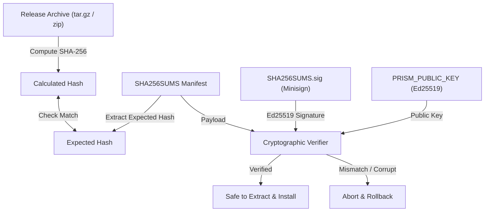

# Cryptographic Release Signing & Verification

All release packages for **prisM. Suite** and its member applications (**triM.**, **steM.**, **beaM.**) are cryptographically signed using **Minisign** with **Ed25519** public-key signatures.

---

## 1. Overview of Release Verification

Every release published to GitHub contains:
1. Target archives:
   - Linux: `<app>-<version>-linux-x86_64.tar.gz`
   - Windows: `<app>-<version>-windows-x86_64.zip`
2. `SHA256SUMS`: A checksum file containing SHA-256 hashes of all assets in the release.
3. `SHA256SUMS.sig`: A detached Minisign signature of the `SHA256SUMS` manifest.



---

## 2. Minisign Key Generation

Minisign keys use Ed25519 digital signatures with key ID headers.

### Generating a New Release Keypair
To generate a new key pair for signing suite releases:

```bash
minisign -G -p prism.pub -s prism.key
```

You will be prompted for a strong passphrase to encrypt `prism.key`.

- `prism.pub`: Public key (safe to distribute and embed into launcher).
- `prism.key`: Secret key (keep secure, never commit to git).

Example public key format:
```
untrusted comment: minisign public key 8A63F01C98E5E729
RWSDx06oK9m3Q5hS6iJb6jX7kE+q7s2NqT4VwPz0Y8U=
```

---

## 3. Configuring the Launcher Public Key

The launcher embeds the public key at compile time.

### Build-time Environment Variable
When compiling `prism-suite` (or in CI):

```bash
PRISM_PUBLIC_KEY="RWSDx06oK9m3Q5hS6iJb6jX7kE+q7s2NqT4VwPz0Y8U=" cargo build --release
```

If not specified, the launcher falls back to a development placeholder key defined in `crates/prism-net/src/lib.rs`.

---

## 4. Signing Releases with `sign-release.sh`

The helper script [`scripts/sign-release.sh`](../scripts/sign-release.sh) automates checksum calculation and signing:

```bash
# Usage:
./scripts/sign-release.sh <directory-with-archives> [path-to-minisign-secret-key]

# Example:
./scripts/sign-release.sh dist/ ~/.minisign/prism.key
```

The script will:
1. Generate `SHA256SUMS` for all `.tar.gz` and `.zip` files in `dist/`.
2. Sign `SHA256SUMS` into `dist/SHA256SUMS.sig` using `minisign`.
3. Verify the generated signature using the matching public key.

---

## 5. Manual Verification

To manually verify downloaded assets from the terminal:

```bash
# 1. Verify the signature of the checksum manifest
minisign -V -p prism.pub -m SHA256SUMS -x SHA256SUMS.sig

# 2. Verify archive hashes against the manifest
sha256sum --check --ignore-missing SHA256SUMS
```

---

## 6. GitHub Actions Automation

In GitHub repository settings (`Settings > Secrets and variables > Actions`):

1. **`MINISIGN_SECRET_KEY`**: The complete contents of `prism.key`.
2. **`MINISIGN_PASSPHRASE`**: The passphrase protecting the secret key.
3. **`PRISM_PUBLIC_KEY`**: The public key string (e.g. `RWSDx06o...`).

The release workflow (`.github/workflows/release.yml`) automatically uses these secrets to sign all release assets and attach `SHA256SUMS` and `SHA256SUMS.sig` to the GitHub release.
